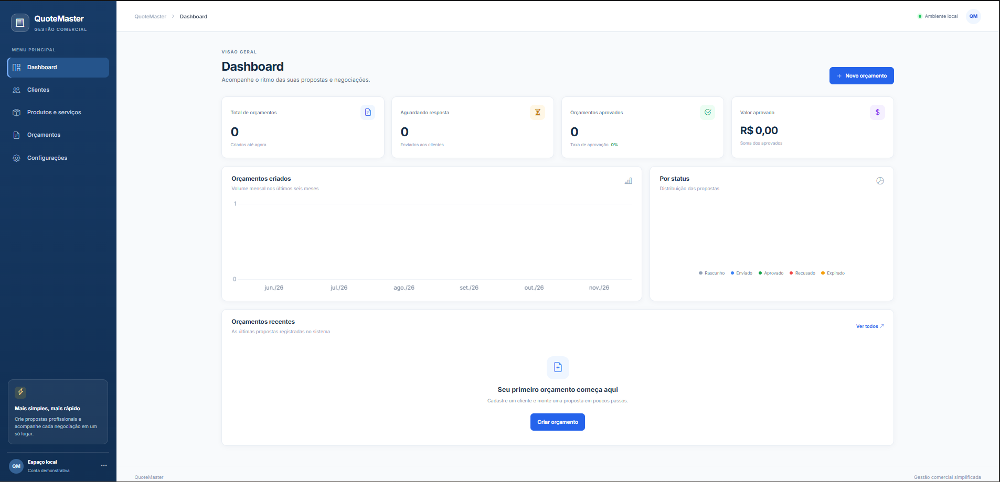
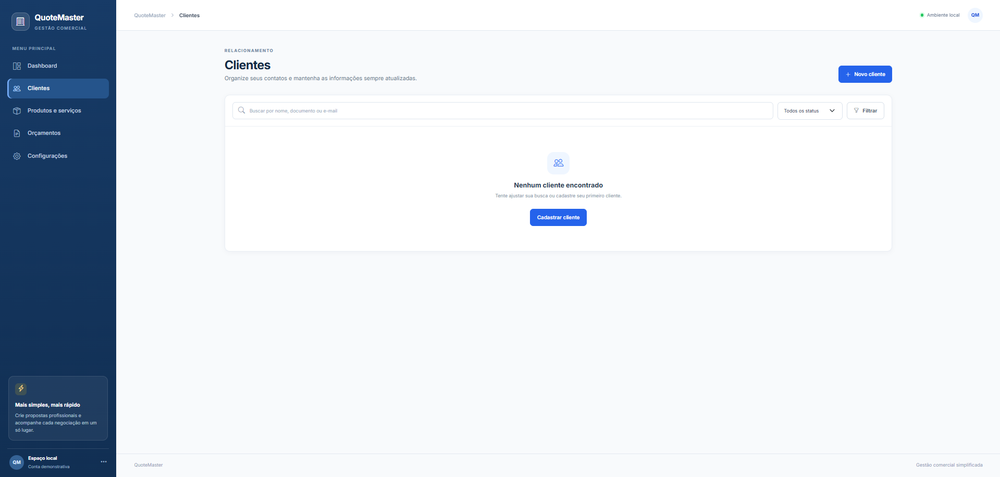
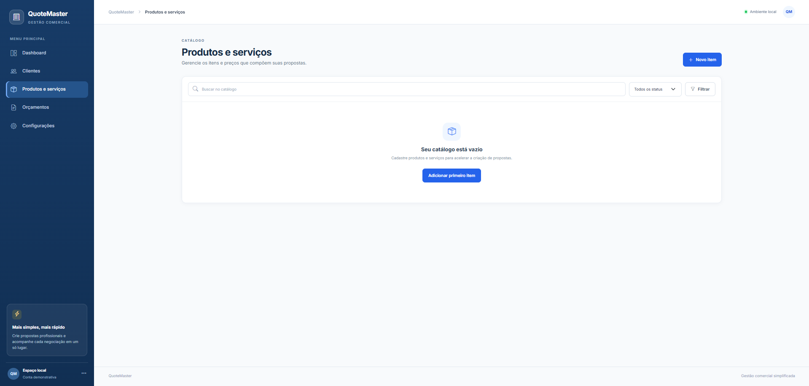
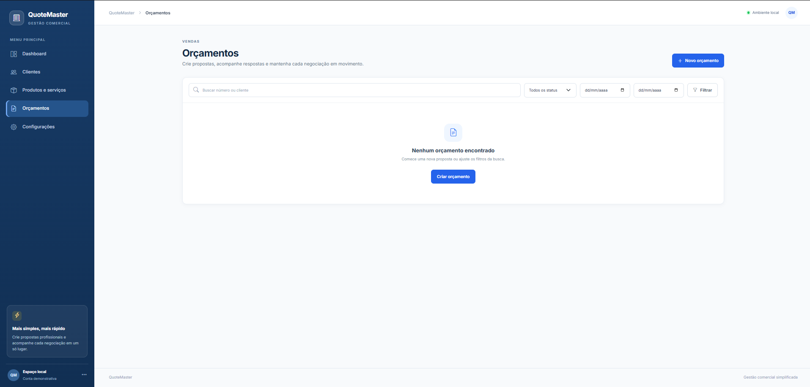
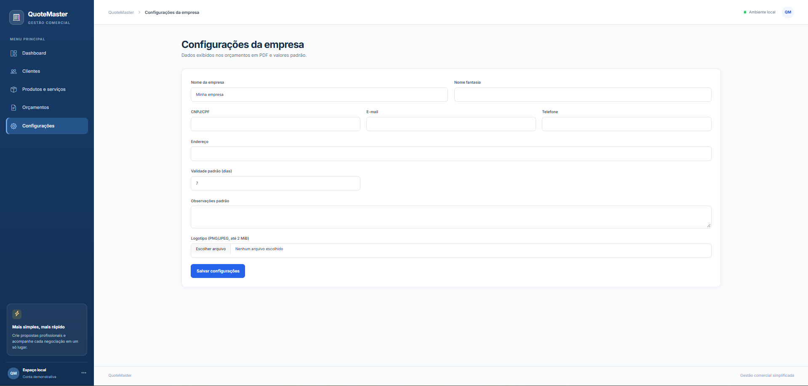

# QuoteMaster

Aplicação web local para cadastro de clientes, produtos e serviços, criação de orçamentos e geração de PDFs profissionais. Stack: C#/.NET 10, ASP.NET Core MVC, EF Core e SQLite.

## Começar

Requer o .NET 10 SDK. Abra a pasta no VS Code ou execute:

```powershell
dotnet restore
dotnet run --project src/QuoteMaster.Web
```

O perfil de desenvolvimento inicia em `http://localhost:5180`, aplica migrations e, somente se o banco estiver vazio, popula cadastros fictícios de demonstração. Para manter a aplicação sem dados de demonstração, use outro ambiente ou desative `DemoData:SeedOnStartup`. O banco local e logotipos ficam fora do Git.

## Recursos

- Cadastro de clientes e catálogo de produtos/serviços.
- Orçamentos com regras financeiras calculadas no servidor, numeração anual e fluxo de status.
- PDF A4 com valores em pt-BR, itens, condições, logotipo e paginação.
- Configurações da empresa, validade e observações padrão; PNG/JPEG de até 2 MiB.
- SQLite com migrations automáticas ao iniciar.

## Estrutura e verificações

`Domain` contém entidades e regras; `Application` os contratos/DTOs; `Infrastructure` a persistência e documentos; `Web` a interface MVC.

```text
Browser → Web/MVC → Application → Domain
                      ↑
                Infrastructure → SQLite / QuestPDF
Launcher → Web (loopback 127.0.0.1)
```

O MVC mantém os fluxos e validações de apresentação; os serviços da aplicação recebem DTOs; o domínio contém regras de status e cálculo; a infraestrutura persiste e gera documentos. SQLite foi escolhido para o cenário local de usuário único, sem serviço de banco separado. O número anual usa uma sequência atualizada atomicamente no SQLite; cotação e itens são persistidos em uma única operação do EF Core.

```powershell
dotnet test
dotnet build -c Release
```

Migration: `dotnet ef migrations add Nome --project src/QuoteMaster.Infrastructure --startup-project src/QuoteMaster.Web`. Veja [docs/database.md](docs/database.md) para relação entre dados, backup e restauração.

## Distribuição Windows

Execute `powershell -ExecutionPolicy Bypass -File scripts/Build-Distribution.ps1` com .NET 10 SDK e Inno Setup 7. Isso gera instalador x64 e ZIP self-contained. O runtime não precisa estar instalado na máquina cliente. Banco, backups, logotipos e logs ficam em `%LOCALAPPDATA%\QuoteMaster`, fora dos binários; a desinstalação os preserva. O atalho de demonstração usa uma pasta separada e reinicia os dados fictícios ao ser reaberto. Consulte [docs/distribution.md](docs/distribution.md) e o [rascunho de release](docs/release-notes-v1.0.0.md).

## Demonstração e portfólio

Dados de demonstração são fictícios e mostram uma empresa marcada “DEMONSTRAÇÃO”, cinco clientes, dez itens de catálogo e dez orçamentos em diferentes estados. O roteiro comercial e o roteiro de vídeo estão em [docs/commercial-kit.md](docs/commercial-kit.md). As imagens abaixo são capturas da interface do QuoteMaster.

### Dashboard



### Clientes e catálogo

<p align="center">
  
  
</p>

### Orçamentos e configurações

<p align="center">
  
  
</p>

## Licença do PDF

A configuração local seleciona `Evaluation` para desenvolvimento, testes e avaliação. Antes de produção, a organização que usa ou se beneficia do sistema deve verificar qual licença QuestPDF se aplica; Community não é automaticamente válida para qualquer uso comercial. Consulte o [guia oficial](https://www.questpdf.com/license/guide.html) e a [configuração](https://www.questpdf.com/license/configuration.html). Configure `QuestPdf:LicenseType` ou `QuestPdf__LicenseType` de acordo com o cenário.

## Estado da versão

A versão publicada no GitHub tem workflow GitHub Actions e pacote Windows gerado localmente. A release binária ainda depende de instalação/atualização em máquina limpa, backup/restauração testados, validação da licença de produção e CI aprovada. O app é local e de usuário único; não inclui login, rede, sincronização, multiusuário, SaaS, emissão fiscal ou atualizador automático.

## English

QuoteMaster is a local .NET 10 MVC app for managing customers, products/services, quotations, and A4 quotation PDFs. It uses SQLite and EF Core migrations. Run with `dotnet run --project src/QuoteMaster.Web`, and verify with `dotnet test` and `dotnet build -c Release`. Development seeds fictional demo data only when the database is empty. The QuestPDF Evaluation setting is for local development/evaluation; verify production license eligibility before deployment.
