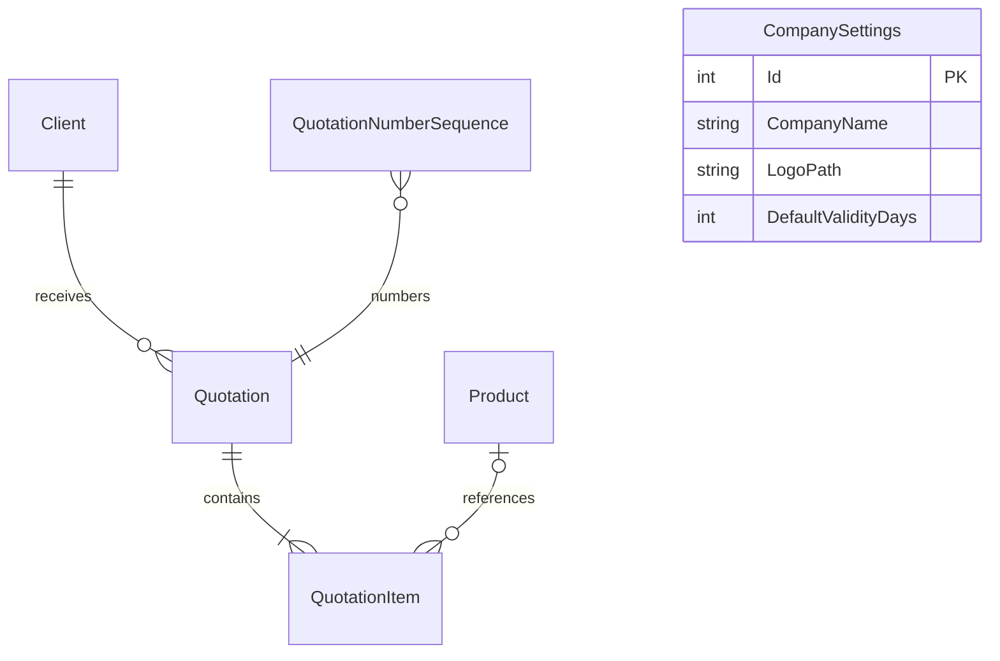

# Banco de dados

O SQLite é migrado na inicialização. `CompanySettings` usa a chave fixa 1 e guarda somente o nome do arquivo do logotipo. Arquivos ficam em `src/QuoteMaster.Web/App_Data/CompanyLogos` (ou caminho `Storage:CompanyLogosDirectory`).

Faça backup consistente com a aplicação parada e arquive o arquivo SQLite junto com `App_Data/CompanyLogos`. Para restaurar, recoloque ambos no mesmo local e execute a aplicação. Não copie o arquivo principal enquanto SQLite estiver ativo em modo WAL.
